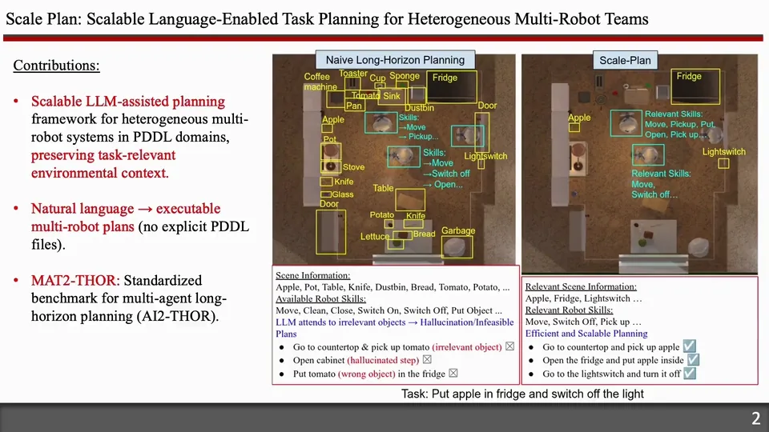
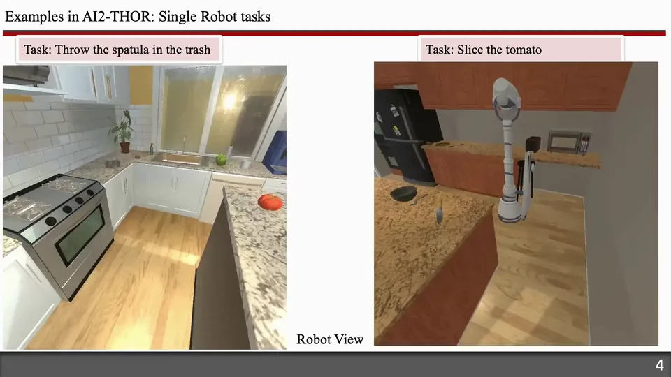
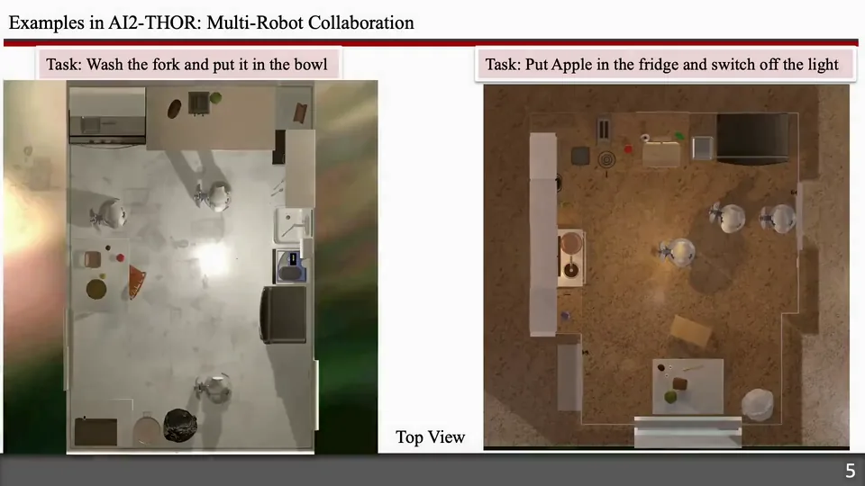
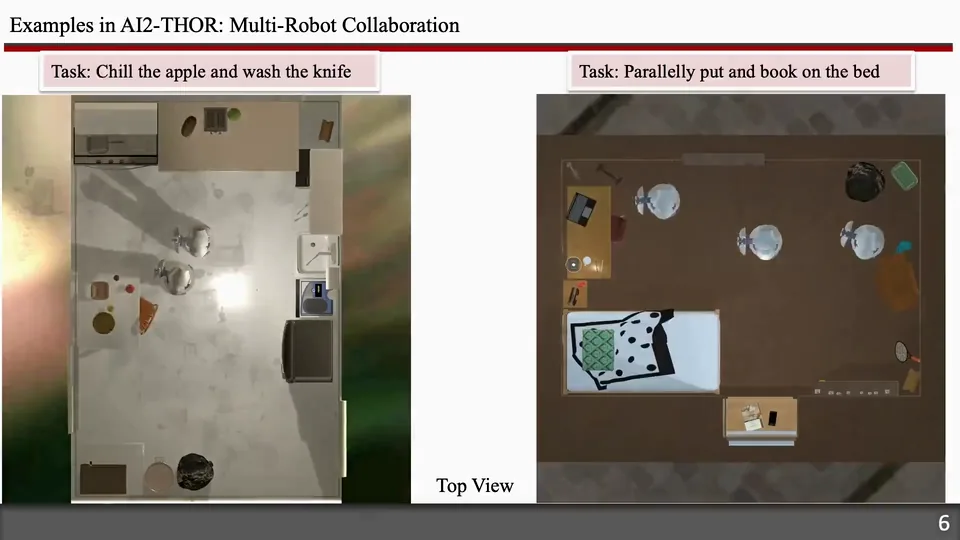

# Scale-Plan: Scalable Language-Enabled Task Planning for Heterogeneous Multi-Robot Teams (IROS 2026)

[Paper](https://arxiv.org/abs/2603.08814)

This is the official implementation of **Scale-Plan**, an LLM-assisted task
planning framework for heterogeneous robot teams in AI2-THOR. Given a PDDL
domain, Scale-Plan identifies task-relevant actions and objects, decomposes and
allocates natural-language tasks, and synthesizes executable action sequences
without generating intermediate PDDL problem files.

The repository also includes the LLM-as-Planner, LLM-PDDL (LLM+P), and LaMMA-P
baselines used in the experiments. The simulation and multi-robot planning
pipeline is adapted from [LaMMA-P](https://github.com/tasl-lab/LaMMA-P) and
extended with the Scale-Plan framework.

## Overview

Scale-Plan constructs an action graph from the PDDL domain, where nodes are
parameterized actions and edges capture dependencies between action effects and
preconditions. At runtime, shallow LLM reasoning identifies likely terminal
actions, and backward graph search extracts the minimal relevant action and
object set. The filtered representation supports task decomposition, robot
allocation, and direct synthesis of executable action sequences while reducing
irrelevant context and combinatorial complexity.

## Videos

### Introduction to Scale-Plan

[](videos/Introduction.mp4)

The following examples are visualized in
[AI2-THOR](https://arxiv.org/abs/1712.05474).

### Single-Robot Examples

[](videos/Ex1.mp4)

### Multi-Robot Examples

[](videos/Ex2.mp4)

[](videos/Ex3.mp4)

## Pipeline

1. Construct an action graph from the PDDL domain.
2. Load a MAT2-THOR task, available robots, and AI2-THOR scene objects.
3. Identify terminal actions relevant to the natural-language instruction.
4. Search the action graph backward to retain relevant actions and objects.
5. Decompose the task, allocate robots, and synthesize an executable plan.
6. Translate the plan into AI2-THOR Python actions, execute it, and evaluate it.

The included hybrid PDDL baselines additionally generate PDDL problem files and
solve them with Fast Downward; this is not part of the Scale-Plan method.

## Repository layout

```text
data/MAT2THOR/          Experiment datasets
resources/              Robot configurations and PDDL domains
videos/                 Introduction and AI2-THOR demonstrations
scripts/
  llm_prompts/          Plain-text LLM prompt templates
  aithor_connect/       AI2-THOR execution runtime
  Scale_Plan_DAG.py     Scale Plan planner
  lamma_p.py            Shared planning pipeline and baselines
  plantocode.py         Generated-plan-to-Python translation
  execute_plan.py       Executable-plan assembly and simulation
  evaluate_results.py   Metric aggregation
  make_table.py         Cross-method result table
logs/                   Generated experiment output
```

## Environment setup

### 1. Python environment

- Python 3.10
- Linux environment capable of running AI2-THOR CloudRendering
- An OpenAI API key

Create the tested Conda environment:

```bash
conda env create -f environment.yml
conda activate scale_plan
```

Alternatively, install the pinned Python dependencies in an existing Python
3.10 environment:

```bash
python -m pip install -r requirements.txt
```

### 2. Fast Downward

Fast Downward is required by the included PDDL-based baselines, but not by
Scale-Plan itself. It is provided as a Git submodule. Initialize and build it
after cloning the repository:

```bash
git submodule update --init --recursive
cd downward
./build.py
./fast-downward.py --help
cd ..
```

To use a separate Fast Downward installation, set `FAST_DOWNWARD_PATH` to its
`fast-downward.py` entry point:

```bash
export FAST_DOWNWARD_PATH=/path/to/downward/fast-downward.py
```

The default location is `downward/fast-downward.py`.

### 3. OpenAI API key

Either set `OPENAI_API_KEY` or place the key in a local text file:

```bash
export OPENAI_API_KEY="your-key"
```

For the complete pipeline, pass a key file to ensure both planning and
plan-to-code translation can authenticate:

```bash
python scripts/run_experiments_parallel.py \
  --openai-api-key-file /path/to/api_key.txt
```

## Dataset format

Datasets belong in `data/MAT2THOR/` and use this naming convention:

```text
FloorPlan<number>.json         Simple tasks
FloorPlan<number>pddl.json     Complex tasks
FloorPlan<number>vague.json    Vague tasks
```

Each file is JSON Lines, with one task per line:

```json
{
  "task": "Put apple in fridge and switch off the light",
  "robot list": [1, 2, 3],
  "object_states": [
    {"name": "Fridge", "contains": ["Apple"], "state": "None"},
    {"name": "LightSwitch", "contains": [], "state": "OFF"}
  ]
}
```

Robot IDs index the configurations in `resources/robots.py`.

## Quickstart

### Complete experiment pipeline

Run all planning, translation, simulation, and evaluation stages:

```bash
python scripts/run_experiments_parallel.py \
  --method Scale_Plan \
  --openai-api-key-file /path/to/api_key.txt \
  --goto-mode teleport
```

Use `--method all` to run every supported method. Available methods are:

- `Scale_Plan`
- `LLM_as_Planner`
- `LLM_PDDL` (LLM+P in the paper)
- `lammap_only_PDDL`
- `lammap`

To run planning jobs sequentially:

```bash
python scripts/run_experiments_sequential.py \
  --method Scale_Plan \
  --openai-api-key-file /path/to/api_key.txt
```

The sequential runner performs planning and plan-to-code translation but does
not automatically run simulation or evaluation.

### Individual stages

Plan a single dataset:

```bash
python scripts/Scale_Plan_DAG.py \
  --floor-plan 15 \
  --file-suffix vague \
  --method Scale_Plan \
  --openai-api-key-file /path/to/api_key.txt
```

Translate generated plans:

```bash
python scripts/plantocode.py \
  --logs-dir logs/logs_Scale_Plan \
  --openai-api-key-file /path/to/api_key.txt
```

Run all simulations for a method:

```bash
python scripts/run_all_simulations_parallel.py \
  --method Scale_Plan \
  --goto-mode teleport
```

Evaluate results and build a comparison table:

```bash
python scripts/evaluate_results.py --method Scale_Plan
python scripts/make_table.py
```

## GoTo modes

AI2-THOR does not provide collision avoidance for multiple robots moving in a
shared environment. The runtime therefore provides two implementations of the
GoTo action:

- `teleport`: teleports robots to selected reachable positions. This mode is
  used for evaluation to prevent robot collisions and navigation failures in
  which robots become stuck.
- `navigation`: physically moves robots through the environment. This mode is
  intended for videos and visual demonstrations.

The mode is selected when simulations are assembled, so generated plans do not
need to change between evaluation and video runs.

## Outputs

Experiment artifacts are written under:

```text
logs/
  logs_<method>/
    simple_tasks/
    complex_tasks/
    vague_tasks/
```

Each experiment directory can contain the generated plans, `log.txt`,
`code_plan_plantocode.py`, `executable_plan.py`, and `results.txt`.
Category-level evaluation summaries are written as `evaluation_summary.txt`;
`make_table.py` writes `logs/evaluation_summary_table.txt`.

## Citation

Scale-Plan was accepted at IROS 2026. If you use it in your research, please
cite:

```bibtex
@inproceedings{gupta2026scaleplan,
  title     = {Scale-Plan: Scalable Language-Enabled Task Planning for Heterogeneous Multi-Robot Teams},
  author    = {Gupta, Piyush and Bae, Sangjae and Li, Jiachen and Isele, David},
  booktitle = {2026 IEEE/RSJ International Conference on Intelligent Robots and Systems (IROS)},
  year      = {2026},
  url       = {https://arxiv.org/abs/2603.08814}
}
```

## Acknowledgements

Scale-Plan builds on [LaMMA-P](https://github.com/tasl-lab/LaMMA-P),
[Fast Downward](https://github.com/aibasel/downward), and
[AI2-THOR](https://ai2thor.allenai.org/). We thank their authors and
maintainers for making these projects publicly available.

## License

Scale-Plan is provided under the terms in [LICENSE.txt](LICENSE.txt).
Third-party components remain subject to their respective licenses; see
[THIRD_PARTY_NOTICES.md](THIRD_PARTY_NOTICES.md).

## Usage notes

- Run commands from the repository root.
- AI2-THOR simulations are resource-intensive. Reduce `--max-workers` if
  parallel runs exhaust CPU, memory, or rendering capacity.
